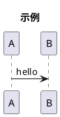

# PlantUML 出图

服务器：`https://plantuml.yii.li`。它只认 PlantUML 的编码 URL（raw deflate + 自定义 base64），不接受直接贴源码的 GET。

**核心约定：不在本地保存渲染结果。** 只写 `.puml` 源码，拼出编码 URL 后用系统默认浏览器打开；不 `curl -o`，不往仓库里放 SVG/PNG。

## 流程

### 1. 写源码

放到项目的临时目录 `tmp/<name>.puml`（本仓库规定临时目录是 `${project_root_dir}/tmp`，不要用 `/tmp`）。



### 2. 编码

用本 skill 目录里的 `encode.py`：

```bash
enc=$(python3 -I ~/.agents/skills/plantuml/encode.py tmp/diagram.puml)
```

编码规则（脚本已实现）：`zlib.compressobj(9, zlib.DEFLATED, -15)` 得到 raw deflate 流，再按 PlantUML 的字母表 `0123456789A-Za-z-_` 每 3 字节编成 4 个字符。**不是**标准 base64，也不能用 gzip 头。

### 3. 浏览器打开

```bash
url="https://plantuml.yii.li/plantuml/svg/$enc"
cmd //c start "" "$url"          # Windows (Git Bash)
# open "$url"                    # macOS
# xdg-open "$url"                # Linux
```

需要位图时把 `/svg/` 换成 `/png/`，但默认用 SVG：矢量、缩放清晰。

### 4. 留存链接

把 URL 写进 `tmp/<name>.url.txt`，用户想再看时直接 `start` 它，不必重新编码：

```bash
printf '%s\n' "$url" > tmp/diagram.url.txt
```

## 服务器行为

- `POST /plantuml/svg` + `Content-Type: text/plain` 也接受明文源码，但它会 **302** 到编码后的 GET 地址；`curl -L` 会陷入重定向循环。要么手动取 `Location` 再 GET，要么直接本地编码（推荐）。
- 图为空或报错时返回的是一张写着 `PlantUML PicoWebServer` 的错误图，通常意味着编码不对（用了标准 base64 / gzip、或漏了 `@startuml`）。
- 中文可正常渲染；PlantUML 会在汉字之间插入一点字距，属正常现象，不用换字体也能读。

## 排版经验（序列图）

- 参与者控制在 5 个以内。服务内部的包/类（如 Store）合并进所属服务，别单独占一条泳道；网页/WebView 这类由客户端自己打开的页面，画成客户端自调用（`C -> C: ...`），不要单列角色。
- `participant` 的声明顺序就是泳道顺序；数据库放最后，避免被挤窄。
- 以下 skinparam 适合中文长文本：

```plantuml
autonumber
skinparam defaultFontName "Microsoft YaHei"
skinparam sequenceMessageAlign left
skinparam responseMessageBelowArrow true
skinparam wrapWidth 300
```

- 消息换行用 `\n`；不要在消息末尾留 `\n`，否则会多出一行空白。
- 用 `== 一、xxx ==` 分段，把“输入 → 分派 → 处理 → 回存 → 查看”这类长流程切开，比一张平铺的图好读。
- `alt` / `opt` / `loop` 的标签写成 `[条件]`，与消息正文区分开。
- 可选流程（如需要额外设备的分支）用 `opt`，并写明该分支默认关闭。

## 自检

打开浏览器前先确认：

1. 源码以 `@startuml` 开头、`@enduml` 结尾；
2. 编码结果只含 `0-9A-Za-z-_`；
3. 保存的 `.url.txt` 与当前 `.puml` 是同一版（改过源码就重新编码）；
4. 没有留下 `.png` / `.svg` 渲染文件。

## encode.py

```python
import sys
import zlib

ALPHABET = "0123456789ABCDEFGHIJKLMNOPQRSTUVWXYZabcdefghijklmnopqrstuvwxyz-_"


def encode(text):
    compressor = zlib.compressobj(9, zlib.DEFLATED, -15)
    data = compressor.compress(text.encode("utf-8")) + compressor.flush()
    out = []
    for i in range(0, len(data), 3):
        chunk = data[i:i + 3]
        b1 = chunk[0]
        b2 = chunk[1] if len(chunk) > 1 else 0
        b3 = chunk[2] if len(chunk) > 2 else 0
        out.append(ALPHABET[b1 >> 2])
        out.append(ALPHABET[((b1 & 0x3) << 4) | (b2 >> 4)])
        if len(chunk) > 1:
            out.append(ALPHABET[((b2 & 0xF) << 2) | (b3 >> 6)])
        if len(chunk) > 2:
            out.append(ALPHABET[b3 & 0x3F])
    return "".join(out)


if __name__ == "__main__":
    with open(sys.argv[1], "r", encoding="utf-8") as f:
        print(encode(f.read()))
```
